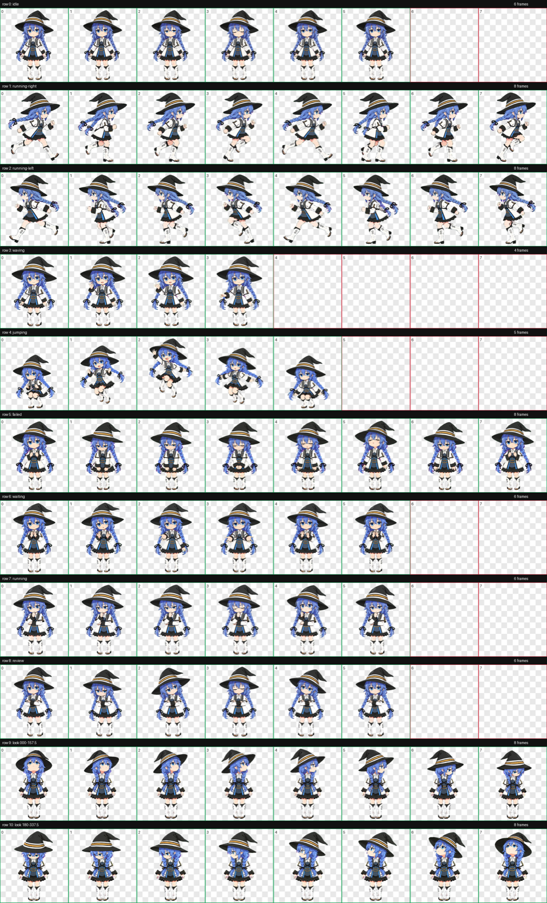
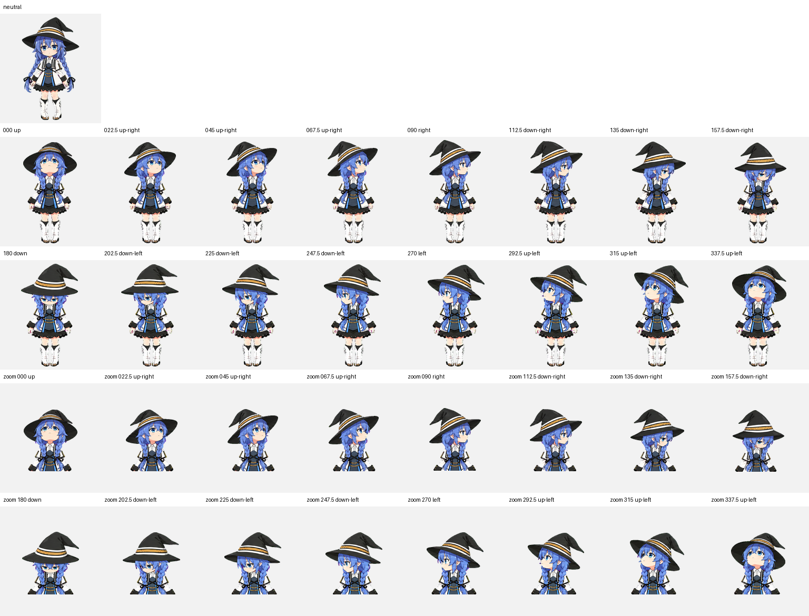
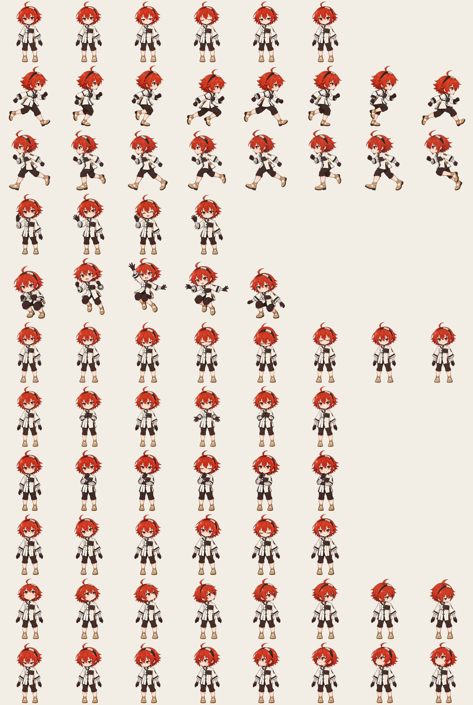
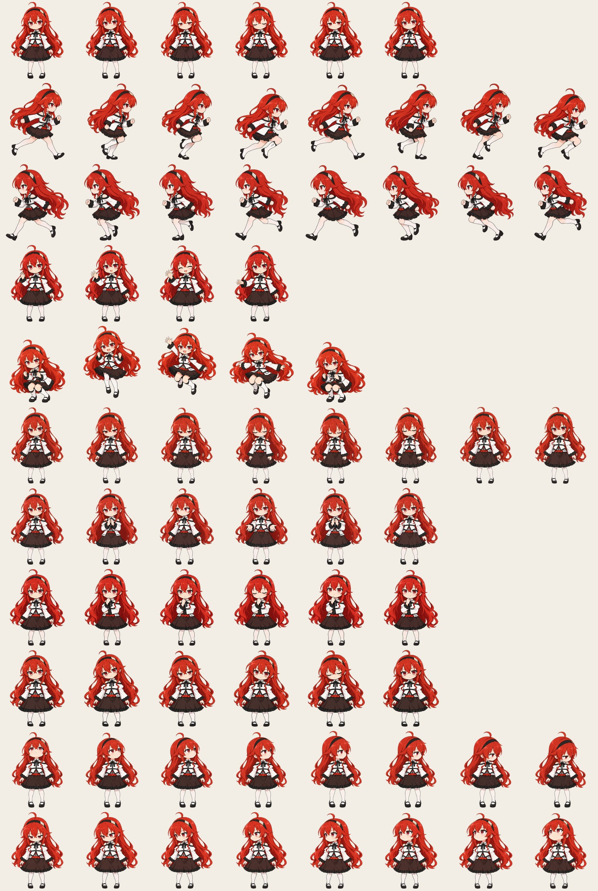

# RoxyMac · 洛琪希桌宠

<p align="center">
  
</p>

<p align="center">
  住在 macOS 桌面上的《无职转生》伙伴：洛琪希与艾丽丝。<br/>
  原生 <b>Swift + AppKit</b> 手写，无 Electron、无第三方运行时依赖，不修改任何其他 App。
</p>

<p align="center">
  
  
  
</p>

---

## 🖼 角色与预览

目前可选 **3 个角色**（右键桌宠 → **角色** 随时切换；每次启动都从洛琪希开始）：

| 洛琪希 · 魔法师 | 艾丽丝 · 短发 · 旅行装 | 艾丽丝 · 长发 · 连衣裙 |
|:---:|:---:|:---:|
|  |  |  |

---

## 📖 目录

1. [项目与角色](#-项目与角色)
   - 1.1 [目录结构](#-目录结构)
   - 1.2 [洛琪希 · 魔法师](#-洛琪希--魔法师)
   - 1.3 [艾丽丝 · 短发 · 旅行装](#-艾丽丝--短发--旅行装)
   - 1.4 [艾丽丝 · 长发 · 连衣裙](#-艾丽丝--长发--连衣裙)
2. [功能与动作](#-功能与动作)
   - 2.1 [功能](#-功能)
   - 2.2 [动作与分镜](#-动作与分镜)
3. [安装与配置](#-安装与配置)
   - 3.1 [快速开始](#-快速开始)
   - 3.2 [构建与发布](#-构建与发布)
   - 3.3 [API 配置](#-api-配置)
4. [使用与联动](#-使用与联动)
   - 4.1 [使用](#-使用)
   - 4.2 [与 Claude Code 联动](#-与-claude-code-联动可选)
     - 4.2.1 [任务执行器（可切换）](#任务执行器可切换)
     - 4.2.2 [状态联动（可多选）](#状态联动可多选)
   - 4.3 [自定义与扩展](#-自定义与扩展)
5. [声明与致谢](#-声明与致谢)
   - 5.1 [隐私](#-隐私)
   - 5.2 [致谢](#-致谢)
   - 5.3 [作者与维护](#-作者与维护)
   - 5.4 [版权](#%EF%B8%8F-%E7%89%88%E6%9D%83)

---

## 🧩 项目与角色

### 📁 目录结构

```
RoxyPet-GitHub/
├── README.md
├── LICENSE              # 代码 MIT；素材附粉丝使用说明
├── CHANGELOG.md
├── .gitignore
├── 01-src/              # 源码
│   ├── main.swift       # 主程序（窗口 / 动画 / 气泡 / 菜单 / 联动）
│   ├── speech.swift     # 洛琪希台词库（运行池 859 条；`--export-speech` 导出 roxy.json）
│   ├── characters.swift # 角色配置、语料与人设加载
│   └── Info.plist
├── 02-assets/           # 素材
│   ├── characters/      # 每个角色一个文件夹
│   │   ├── roxy/        # 洛琪希：序列帧图（8 列 × 11 行）+ character.json
│   │   ├── eris-long/   # 艾丽丝 · 长发：图集 + character.json
│   │   └── eris-short/  # 艾丽丝 · 短发：图集 + character.json
│   ├── speech/          # 语料 JSON：roxy / eris / sylphie
│   ├── Roxy.icns        # 应用图标（由 icon.iconset 生成）
│   ├── icon.iconset/    # 图标源
│   └── pet.json
├── 03-scripts/          # 构建与工具
│   ├── build.sh                 # 编译 → 组装 → 签名，产出 Roxy.app
│   ├── build-and-run.command    # 双击即构建 + 运行
│   ├── make-release.sh          # 一键出安装包（构建 + 打 dmg）
│   ├── import-speech.py         # 语料 Markdown → JSON
│   ├── pack-eris-atlas.py       # 艾丽丝图集打包
│   └── render-character-previews.py  # 预览图 / 动图渲染
├── 04-integration/      # Claude Code / Codex 联动
│   ├── hook.sh
│   └── codex-notify.sh
├── 05-images/           # README 配图
│   ├── icon.png         # 应用图标
│   ├── roxy/            # 洛琪希：立绘 / 总表 / 视线 / 抽帧 / 动图
│   └── eris/            # 艾丽丝：立绘 / 总表 / 动图
├── 06-art-source/       # 人物素材工程：roxy / eris-long / eris-short 三个并列
└── 07-docs/             # 角色扩展 · 语料 · 素材制作记录
```

根目录的构建产物（`Roxy.app`、`*.dmg`）由 `.gitignore` 排除、不入库——仓库本体是纯源码与素材，安装包一律走 Releases 的 dmg。

---

### 🧙 洛琪希 · 魔法师

> 蓝发双辫的**魔族**魔术师（米格路德族）。

| 项目 | 说明 |
|:---|:---|
| **台词库** | 859 条本地台词——打招呼、闲聊，按时段 / 星期 / 情绪自动切换；全部本地随机，零消耗 |
| **菜单措辞** | 「吩咐洛琪希」；Siri 口令：「洛琪希」 |
| **素材工程** | 人物绘图与序列帧动画源文件在 `06-art-source/roxy/` |

| 立绘 | 动作总表（行走图分镜） | 16 向视线帧 |
|:---:|:---:|:---:|
|  |  |  |

| 待机 | 奔跑 | 挥手 | 转头 |
|:---:|:---:|:---:|:---:|
|  |  |  |  |

---

### 🎒 艾丽丝 · 短发 · 旅行装

> 红发少女的旅行装束。

| 项目 | 说明 |
|:---|:---|
| **语料** | 388 条，由 `07-docs/语料/艾莉丝语料库.md` 筛选转换生成（与长发款共享；闲聊 / 情境 / 互动 / 方向 / 系统事件） |
| **菜单措辞** | 「拜托艾丽丝」 |
| **素材工程** | AI 图像生成流程制作（母版 / 动作原图 / 提示词见仓库 `06-art-source/eris-short/`） |

| 立绘 | 动作总表（行走图分镜） |
|:---:|:---:|
|  |  |

| 待机 | 奔跑 | 挥手 | 转头 |
|:---:|:---:|:---:|:---:|
|  |  |  |  |

---

### 👗 艾丽丝 · 长发 · 连衣裙

> 白色露肩上衣、黑色领结、深棕荷叶边裙。

| 项目 | 说明 |
|:---|:---|
| **语料** | 与短发款共用同一套 388 条 |
| **菜单措辞** | 「拜托艾丽丝」 |
| **素材工程** | AI 图像生成流程制作（与短发款同一工程，见仓库 `06-art-source/eris-long/`） |

| 立绘 | 动作总表（行走图分镜） |
|:---:|:---:|
|  |  |

| 待机 | 奔跑 | 挥手 | 转头 |
|:---:|:---:|:---:|:---:|
|  |  |  |  |

---

菜单和窗口随人物切换：洛琪希是「**吩咐洛琪希**」，艾丽丝是「**拜托艾丽丝**」；隐藏 / 显示、退出、设置、记录窗口与 AI 人设一起更新。长短发艾丽丝共享语料和 Claude 会话，历史记录保留当时的角色名称。

艾丽丝语料由项目内 Markdown 导入；希露菲语料已预留，待有模型后可接入。[添加角色与语料说明](07-docs/角色与语料扩展.md)。

---

## 🎬 功能与动作

### ✨ 功能

- 🐾 **桌面互动**：鼠标放到她身上 → 跳一下 / 挥一下手（交替）；移开后 → 转头 / 转眼跟随你的鼠标（16 个方向实时切换）
- 🎭 **拖动**：按住拖动，她会朝拖动方向奔跑（左拖向左跑、右拖向右跑）
- 💬 **洛琪希 859 条台词库**：打招呼、闲聊、按时段/星期/情绪自动切换；全部本地随机，零消耗
- ⏰ **硬件联动**：整点报时（深夜自动静音）、电池低电量提醒、电量充满庆祝
- 🤝 **Claude Code 联动**（可选）：你发消息 → 她跑动"工作"；回答完毕 → 挥手报告，气泡里带回复摘要，点气泡跳回对应终端窗口
- 📮 **吩咐洛琪希**：闲聊直接走 API 当场回答（又快又省）；需要动手的任务勾选后交给本机 Claude Code 执行。对话**全程留档**（聊天气泡 + Markdown 渲染，永久保存可翻查），结果自动进剪贴板
- 🫥 **一键隐身**：菜单栏常驻一个小图标（和后台 App 一样）；右键菜单或点图标即可「隐藏洛琪希 / 显示洛琪希」——隐身时她在后台安静待命，随时召回
- 🔮 **透视魔法**（可选）：截屏交给视觉大模型，用洛琪希的口吻点评你的屏幕
- 🗣 **Siri 唤醒**：配合「快捷指令」导入一条指令后，喊「嘿 Siri，洛琪希」即可召唤
- 🪶 **原生轻量**：单个可执行文件 + 角色序列帧图；无网络请求（本机外部功能除外，见「隐私」）

---

### 🎞 动作与分镜

每位角色的所有动作——待机、奔跑、挥手、跳跃、转头看您……都画在各自的序列帧图里（洛琪希：`02-assets/characters/roxy/spritesheet.png`；艾丽丝：`02-assets/characters/eris-*/spritesheet.png`），逐帧切换就成了动画。

| 行 | 动作 | 出现时机 |
|:---:|---|---|
| 0 | `idle` 待机 | 平时发呆 |
| 1 | `running-right` 向右跑 | 向右拖动时 |
| 2 | `running-left` 向左跑 | 向左拖动时 |
| 3 | `waving` 挥手 | 打招呼 / 干完活向你报告 |
| 4 | `jumping` 跳跃 | 鼠标碰到她 / 需要你确认时 |
| 5 | `failed` 受挫 | 任务失败时 |
| 6 | `waiting` 等待 | 等待你操作时 |
| 7 | `running` 跑动 | 正在干活（Claude Code 工作中）|
| 8 | `review` 检视 | 检查结果时 |
| 9–10 | 16 向视线 | 转头跟随鼠标：0°=正上，顺时针每 22.5° 一档 |

---

## 🛠 安装与配置

### 🚀 快速开始

**方式一：下载成品（推荐给只想用的）**

到 [Releases](../../releases) 下载 `Roxy.dmg` → 把 App 拖进「应用程序」。
首次打开若提示"无法验证开发者"：右键 App → 打开 → 再点「打开」。

**方式二：双击构建（推荐给想看源码的）**

双击 `03-scripts/build-and-run.command` —— 自动编译、打包并打开桌宠。
（首次双击若被系统拦截：右键该文件 → 打开）

**方式三：命令行**

```bash
cd 03-scripts
./build.sh            # 产出 Roxy.app 到仓库根目录
open ../Roxy.app
```

> 运行要求：macOS 14+（Apple Silicon）；构建需要 Xcode Command Line Tools（`xcode-select --install`）。

---

### 🔧 构建与发布

Releases 里的 `Roxy.dmg` **不是来路不明的二进制**——它完全由本仓库里可见的源码与素材、通过仓库内两个公开脚本构建而来：

```
01-src/ + 02-assets/                ← 你正在看的一切（人类可读）
      │
      │  03-scripts/build.sh
      │   ① swiftc 把 main.swift + speech.swift + characters.swift 编译成机器码可执行文件
      │   ② 与 Info.plist、spritesheet.png、Roxy.icns 一起组装为 Roxy.app
      │   ③ codesign 签名
      ▼
  Roxy.app
      │
      │  03-scripts/make-release.sh
      │   把 App + Applications 快捷方式 压成只读磁盘镜像（图标布局固定：app 在左、Applications 在右）
      ▼
  Roxy.dmg                          ← Releases 里供下载的安装包
```

**任何人都可以原地复现**：

```bash
git clone <本仓库>
cd RoxyPet-GitHub/03-scripts
./make-release.sh         # 走同一条流水线，构建出同款安装包
```

**这条流水线为什么让人放心**：

- **零第三方依赖**：构建只用到 macOS 自带工具（`swiftc` / `codesign` / `hdiutil`），全程不联网、不下载任何东西
- **脚本极短可读**：`build.sh` 与 `make-release.sh` 加起来不到 80 行，从头到尾读完用不了一分钟
- **安装包内容一目了然**：挂载 dmg 或右键「显示包内容」，里面只有——`Roxy` 可执行文件（由 01-src 编译）、`spritesheet.png`（02-assets）、`Roxy.icns`、`Info.plist`；**没有任何安装器脚本、没有自启动项、不联网**
- **对任何二进制都保持警惕的话**：可以完全跳过 dmg——直接 clone 源码自己跑一遍 `build.sh`，得到的应用与发布包出自同一条流水线

> 发布包的 SHA-256 校验值会随每次 Release 说明一同提供，便于校验下载完整性。

---

### 🔌 API 配置

这三项功能需要一个 **Anthropic 兼容 API**，两种配置方式任选：

1. **自动沿用 Claude Code 配置**：若本机已安装并配置过 Claude Code（`~/.claude/settings.json` 中已填端点与 Key），无需任何设置，开箱即用
2. **在桌宠内单独配置**：右键她（或点菜单栏图标）→「**API 设置…**」，填写三栏：
   - **接口地址**：如 `https://api.anthropic.com`（官方）或 `https://api.deepseek.com/anthropic`（DeepSeek）
   - **API Key**
   - **模型名**：如 `claude-sonnet-5-5` 或 `deepseek-flash`

未配置时点击这三项功能，她会主动弹窗请你配置。凭据只保存在本机。

---

## 🎮 使用与联动

### 🖱 使用

| 操作 | 她的反应 |
|---|---|
| 鼠标悬停 | 跳一下 / 挥一下手（交替出现；转头跟随中不打断）|
| 悬停后移动鼠标 | 转头跟随（约 5 秒）|
| 按住拖动 | 朝拖动方向奔跑 |
| 单击她 | 随机说一句本地台词；动作：首次必挥手，之后跳 / 挥手交替（859 条台词库，零消耗）|
| 右键「吩咐洛琪希…」 | 输入想说的话（她直接回答）；勾选「让她动手做」则交给 Claude Code 执行（全程有记录）|
| 右键 | 说句话（本地台词）· 说句话（大模型）｜吩咐洛琪希…（聊天 / 做事）· 看看屏幕（透视魔法）｜查看吩咐记录 · 回到屏幕右下角｜隐藏洛琪希 / 退出洛琪希｜最底部：设置…（称呼 / API / 执行器 / 联动）|
| 菜单栏小图标 | 随时隐藏 / 显示她，或使用全部菜单功能（隐身时点任意功能会自动唤出）|

---

### 🤝 与 Claude Code 联动（可选）

把 `04-integration/hook.sh` 复制到 `~/.roxy-pet/hook.sh`，然后给 `~/.claude/settings.json` 添加 hooks：

```json
{
  "hooks": {
    "UserPromptSubmit": [{ "hooks": [{ "type": "command", "command": "~/.roxy-pet/hook.sh working" }] }],
    "Stop":             [{ "hooks": [{ "type": "command", "command": "~/.roxy-pet/hook.sh done" }] }],
    "Notification":     [{ "hooks": [{ "type": "command", "command": "~/.roxy-pet/hook.sh notice" }] }],
    "SessionEnd":       [{ "hooks": [{ "type": "command", "command": "~/.roxy-pet/hook.sh idle" }] }]
  }
}
```

- 你发消息 → 她跑动（工作中）；回答完毕 → 挥手报告，气泡带回复摘要
- 点气泡 → 复制摘要并跳回对应的终端窗口（Terminal / iTerm2）
- 「吩咐洛琪希」：聊天直连 API；勾选「让她动手做」时走本机 `claude` CLI（需已配置 Claude Code；该模式以跳过权限确认的方式执行，请只吩咐你信任的任务）

#### 任务执行器（可切换）

「吩咐洛琪希」勾选「让她动手做」时由哪个工具执行，可在 **设置 → 任务执行器** 里切换（自动探测本机已安装的 CLI）：

| 选项 | 命令 | 说明 |
|---|---|---|
| **Claude Code** | `claude -p` | 默认；持久会话（跨任务记忆）|
| **Codex** | `codex exec` | 沙箱自治模式（workspace-write 沙箱 + 自动审批复核）；每次任务独立会话 |
| **opencode** | `opencode run` | 自动批准（尊重显式 deny 规则）；会话续接 |
| **仅对话** | — | 勾选也只聊天，不执行命令 |

> 三种 CLI 均以无头模式运行，并以各自的"自动执行"参数工作——**请只吩咐你信任的任务**。

#### 状态联动（可多选）

在 设置 →「状态联动」里勾选任意组合，她在对应工具干活时就有反应：

| 工具 | 机制 | 效果 | 需要做什么 |
|---|---|---|---|
| **Claude Code** | hooks → `state.claude` | 干活跑动 / 完工挥手+回复转述 / 等待提醒 | 配好上面的 hooks（`hook.sh`）|
| **Codex** | `notify` → `codex-notify.sh` | 完工挥手 + 回复转述 | `~/.codex/config.toml`：`notify = ["…/.roxy-pet/codex-notify.sh", "turn-ended"]`（若已有 notify 程序，在脚本里先转发，见脚本注释）|
| **opencode** | 进程检测（`opencode run`） | 运行中跑动 / 结束挥手 | 无需配置，勾选即可 |

「任务执行器」（派活给谁）与「状态联动」（盯谁干活）相互独立：你可以派活给 Claude Code，同时盯着 Codex 和 opencode 的动态。

---

### 🎨 自定义与扩展

- **台词**：改 `01-src/speech.swift`（每个池子都是纯字符串数组），运行时追加可放 `~/.roxy-pet/speech.json`
- **手感参数**（`01-src/main.swift` 顶部）：`WINDOW_SCALE` 显示大小、`LOOK_WINDOW_SECONDS` 跟随秒数、`HEAD_CENTER_Y_RATIO` 视角基准、`CHIME_QUIET_FROM/TO` 报时静音时段
- **换角色**：右键 →「角色」即可切换；无需替换洛琪希原图

**添加一位新角色（扩展落位表）**——每样东西只有一个去处，复制模板即可：

| 内容 | 落位 | 生成方式 |
|---|---|---|
| 序列帧图 + 角色配置 | `02-assets/characters/<角色ID>/`（如 `roxy/`、`eris-long/`） | 复制 `07-docs/人物模板/` 后替换字段与图 |
| 语料 JSON（成品） | `02-assets/speech/<人物ID>.json`（现有 roxy / eris / sylphie） | 由 md 原稿筛选转换生成——`03-scripts/import-speech.py`（`build.sh` 每次构建自动跑），**不要手改** |
| 语料原稿（求全） | `07-docs/语料/<人物ID>.md` | 唯一稿源，**改台词只改这里**（见 [语料位置](07-docs/语料/语料位置.md)） |
| 素材工程（母版 / 原图 / 提示词 / 帧） | `06-art-source/<装束ID>/` | 生成流程留档 |
| 预览图（可选） | `05-images/<人物ID>/` | `03-scripts/render-character-previews.py` |

### 📚 语料为什么有两种格式

仓库里的语料同时有 **Markdown 原稿**和 **JSON 成品**。它们不是两份语料，而是「原稿 → 成品」的关系（类似源码 → 编译产物）：

```text
07-docs/语料/<人物>.md           ① 原稿：求全。台词、透视魔法提示词、菜单措辞、统计说明全写在一起
        │  ② 筛选转换：03-scripts/import-speech.py（build.sh 每次构建都会自动跑）
        ▼
02-assets/speech/<人物>.json     ③ 成品：只装程序要说的台词，按固定分类键归位
        │  build.sh 打包进 app
        ▼
Roxy.app/Contents/Resources/speech/<人物>.json   ④ 运行时读取（~/.roxy-pet/speech/ 可覆盖）
```

**转换时会筛掉什么**（完整规则见 [语料位置](07-docs/语料/语料位置.md)）：

- 只收「标题末尾带 `（key）`」的段落里、代码块中的非空行——一个非空行就是一条台词；
- 标题、空行、普通正文、透视魔法的系统提示词、右键菜单措辞、扩展说明，都不进 JSON（程序不读这些）；
- 整点报时那张表会转成 `hourly_*` 键，其中不含 `{h}` 的行不收；
- 必需分类（闲聊 / 问候 / 摸头 / 拖动 / 四方位 / AI 思考与失败）少一个，脚本直接报错，不会生成残缺的 JSON。

**结论**：改台词只改 md 一处 → 跑 `python3 03-scripts/import-speech.py`（构建时自动跑）→ JSON 现生成。手改 JSON 是白改，下次一跑就被覆盖。

运行时也可扩展：`~/.roxy-pet/characters/` 放角色文件夹、`~/.roxy-pet/speech/<人物ID>.json` 放语料，点「重新载入角色与语料」即刻生效。完整规范：[角色扩展说明](07-docs/角色与语料扩展.md)。

---

## 📄 声明与致谢

### 🔒 隐私

- 桌宠本体**不联网**：台词、动画、互动全部本地运算
- 纯聊天直连你**自己配置**的 API；勾选「让她动手做」时调用本机 `claude` CLI（跳过权限确认执行）；「透视魔法 / 想句话」同样读取 `~/.claude/settings.json` 中的端点与凭据
- 所有任务与历史记录只写入本机 `~/.roxy-pet/`，不上传任何地方

---

### 💛 致谢

- **[易轩（JensenTong）](https://github.com/Emulation174)** —— 负责本项目中**洛琪希的角色美术与序列帧动画**（Character Art & Sprite Animation）。
- **[洛琪希图书馆](https://pan.roxylib.com/)** —— 原作文本资料
- **[ChatGPT](https://chatgpt.com/)** —— 艾丽丝素材（AI 图像生成）与多角色功能的协作开发
- **[DeepSeek](https://www.deepseek.com/)** —— 文本创作协助与 API 对话支持

---

### 🐾 作者与维护

项目由 **[Cleste](https://github.com/cleste-pome)** 发起、开发与维护。

---

### ⚖️ 版权

- 《无职转生 ～到了异世界就拿出真本事～》：原作 **理不尽な孫の手**、插画 **シロタカ**、动画制作 **Studio Bind**；相关版权归原作者及上述权利方所有
- 本项目为**非商业粉丝作品**：仓库内美术素材请勿商用；再分发本代码时请替换为你自己拥有权利的素材
