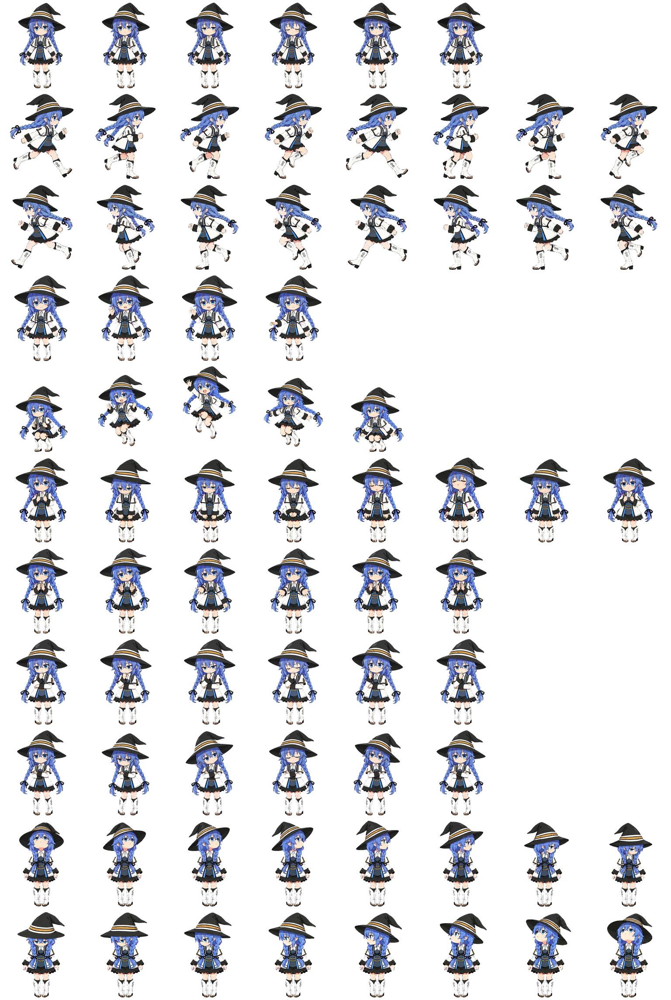

# RoxyPet · 洛琪希桌宠

<p align="center">
  
</p>

<p align="center">
  一只住在 macOS 桌面上的洛琪希 —— 《无职转生》的蓝发魔术师。<br/>
  原生 <b>Swift + AppKit</b> 手写，无 Electron、无第三方运行时依赖，不修改任何其他 App。
</p>

<p align="center">
  
  
  
</p>

---

## 🖼 预览

| 立绘 | 动作总表（行走图分镜） |
|:---:|:---:|
|  |  |

**动态预览**（真·动图，打开仓库就能看见她在动）：

| 待机 | 奔跑 | 挥手 | 转头 |
|:---:|:---:|:---:|:---:|
|  |  |  |  |

| 16 向视线帧（转头跟随鼠标） | 动画抽帧预览 |
|:---:|:---:|
|  |  |

## ✨ 功能

- 🐾 **桌面互动**：鼠标放到她身上 → 跳跃；移开后 → 转头 / 转眼跟随你的鼠标（16 个方向实时切换）
- 🎭 **拖动**：按住拖动，她会朝拖动方向奔跑（左拖向左跑、右拖向右跑）
- 💬 **934 条台词库**：打招呼、闲聊、按时段/星期/情绪自动切换；全部本地随机，零消耗
- ⏰ **硬件联动**：整点报时（深夜自动静音）、电池低电量提醒、电量充满庆祝
- 🤝 **Claude Code 联动**（可选）：你发消息 → 她跑动"工作"；回答完毕 → 挥手报告，气泡里带回复摘要，点气泡跳回对应终端窗口
- 🗂 **吩咐做事**：右键把任务交给本机 Claude Code 执行；对话**全程留档**（查看吩咐记录，永久保存可翻查），结果自动进剪贴板
- 🔮 **透视魔法**（可选）：截屏交给视觉大模型，用洛琪希的口吻点评你的屏幕
- 🗣 **Siri 唤醒**：配合「快捷指令」导入一条指令后，喊「嘿 Siri，洛琪希」即可召唤
- 🪶 **原生轻量**：单个可执行文件 + 一张精灵图；无网络请求（本机外部功能除外，见「隐私」）

## 🎞 动作与分镜

她的一切动画都来自一张精灵图 `02-assets/spritesheet.png`（pets v2 规格：**8 列 × 11 行**，单格 192×208）：

| 行 | 动作 | 出现时机 |
|:---:|---|---|
| 0 | `idle` 待机 | 平时发呆 |
| 1 | `running-right` 向右跑 | 向右拖动时 |
| 2 | `running-left` 向左跑 | 向左拖动时 |
| 3 | `waving` 挥手 | 打招呼 / 干完活向你报告 |
| 4 | `jumping` 跳跃 | 鼠标碰到她 / 需要你确认时 |
| 5 | `failed` 受挫 | 任务失败时 |
| 6 | `waiting` 等待 | 等待你操作时 |
| 7 | `running` 跑动 | 正在干活（Claude Code 工作中）|
| 8 | `review` 检视 | 检查结果时 |
| 9–10 | 16 向视线 | 转头跟随鼠标：0°=正上，顺时针每 22.5° 一档 |

<details>
<summary>📜 展开完整精灵图</summary>
<p align="center"></p>
</details>

## 🚀 快速开始

**方式一：下载成品（推荐给只想用的）**

到 [Releases](../../releases) 下载 `RoxyPet-v1.0.dmg` → 把 App 拖进「应用程序」。
首次打开若提示"无法验证开发者"：右键 App → 打开 → 再点「打开」。

**方式二：双击构建（推荐给想看源码的）**

双击 `03-scripts/build-and-run.command` —— 自动编译、打包并打开桌宠。
（首次双击若被系统拦截：右键该文件 → 打开）

**方式三：命令行**

```bash
cd 03-scripts
./build.sh            # 产出 RoxyPet.app 到仓库根目录
open ../RoxyPet.app
```

> 运行要求：macOS 14+（Apple Silicon）；构建需要 Xcode Command Line Tools（`xcode-select --install`）。

## 🔧 构建与发布：安装包是可复现的

Releases 里的 `RoxyPet-v1.0.dmg` **不是来路不明的二进制**——它完全由本仓库里可见的源码与素材、通过仓库内两个公开脚本构建而来：

```
01-src/ + 02-assets/                ← 你正在看的一切（人类可读）
      │
      │  03-scripts/build.sh
      │   ① swiftc 把 main.swift + speech.swift 编译成机器码可执行文件
      │   ② 与 Info.plist、spritesheet.png、RoxyPet.icns 一起组装为 RoxyPet.app
      │   ③ codesign 签名
      ▼
  RoxyPet.app
      │
      │  03-scripts/make-release.sh
      │   把 App + Applications 快捷方式 + 安装说明 压成只读磁盘镜像
      ▼
  RoxyPet-v1.0.dmg                  ← Releases 里供下载的安装包
```

**任何人都可以原地复现**：

```bash
git clone <本仓库>
cd RoxyPet-GitHub/03-scripts
./make-release.sh 1.0     # 走同一条流水线，构建出同款安装包
```

**这条流水线为什么让人放心**：

- **零第三方依赖**：构建只用到 macOS 自带工具（`swiftc` / `codesign` / `hdiutil`），全程不联网、不下载任何东西
- **脚本极短可读**：`build.sh` 与 `make-release.sh` 加起来不到 80 行，从头到尾读完用不了一分钟
- **安装包内容一目了然**：挂载 dmg 或右键「显示包内容」，里面只有——`RoxyPet` 可执行文件（由 01-src 编译）、`spritesheet.png`（02-assets）、`RoxyPet.icns`、`Info.plist`；**没有任何安装器脚本、没有自启动项、不联网**
- **对任何二进制都保持警惕的话**：可以完全跳过 dmg——直接 clone 源码自己跑一遍 `build.sh`，得到的应用与发布包出自同一条流水线

> 发布包的 SHA-256 校验值会随每次 Release 说明一同提供，便于校验下载完整性。

## 🖱 使用

| 操作 | 她的反应 |
|---|---|
| 鼠标悬停 | 跳跃 |
| 悬停后移动鼠标 | 转头跟随（约 10 秒）|
| 按住拖动 | 朝拖动方向奔跑 |
| 单击她 / 右键「吩咐做事」 | 输入任务 → 交给本机 Claude Code 执行（有记录）|
| 右键 | 菜单：说句话 / 吩咐做事 / 查看吩咐记录 / 透视魔法 / 想句话 / 回位 / 退出 |

## 🤝 与 Claude Code 联动（可选）

把 `04-integration/hook.sh` 复制到 `~/.roxy-pet/hook.sh`，然后给 `~/.claude/settings.json` 添加 hooks：

```json
{
  "hooks": {
    "UserPromptSubmit": [{ "hooks": [{ "type": "command", "command": "~/.roxy-pet/hook.sh working" }] }],
    "Stop":             [{ "hooks": [{ "type": "command", "command": "~/.roxy-pet/hook.sh done" }] }],
    "Notification":     [{ "hooks": [{ "type": "command", "command": "~/.roxy-pet/hook.sh notice" }] }],
    "SessionEnd":       [{ "hooks": [{ "type": "command", "command": "~/.roxy-pet/hook.sh idle" }] }]
  }
}
```

- 你发消息 → 她跑动（工作中）；回答完毕 → 挥手报告，气泡带回复摘要
- 点气泡 → 复制摘要并跳回对应的终端窗口（Terminal / iTerm2）
- 「吩咐做事」走本机 `claude` CLI（需要已安装并配置好 Claude Code）

## 🎨 自定义

- **台词**：改 `01-src/speech.swift`（每个池子都是纯字符串数组），运行时追加可放 `~/.roxy-pet/speech.json`
- **手感参数**（`01-src/main.swift` 顶部）：`WINDOW_SCALE` 显示大小、`LOOK_WINDOW_SECONDS` 跟随秒数、`HEAD_CENTER_Y_RATIO` 视角基准、`CHIME_QUIET_FROM/TO` 报时静音时段
- **换角色**：替换 `02-assets/spritesheet.png` 即可（保持 8 列 × 11 行规格）

## 📁 目录结构

```
RoxyPet-GitHub/
├── README.md
├── LICENSE              # 代码 MIT；素材附粉丝使用说明
├── CHANGELOG.md
├── .gitignore
├── 01-src/              # 源码
│   ├── main.swift       # 主程序（窗口/动画/气泡/菜单/联动）
│   ├── speech.swift     # 934 条台词库
│   └── Info.plist
├── 02-assets/           # 素材
│   ├── spritesheet.png  # 精灵图（8 列 × 11 行）
│   ├── RoxyPet.icns     # 应用图标
│   └── pet.json
├── 03-scripts/          # 构建
│   ├── build.sh
│   ├── build-and-run.command   # 双击即构建 + 运行
│   └── make-release.sh         # 一键出安装包（构建 + 打 dmg）
├── 04-integration/      # Claude Code 联动
│   └── hook.sh
└── 05-images/           # README 配图（含 4 张动图预览）
```

构建产物（`RoxyPet.app`、`*.dmg`）会生成在根目录，已被 `.gitignore` 排除、**不进仓库**——成品统一走 Releases 里的 dmg。

## 🔒 隐私

- 桌宠本体**不联网**：台词、动画、互动全部本地运算
- 「吩咐做事」调用你自己机器上的 `claude` CLI；「透视魔法 / 想句话」读取你**自己配置**的 `~/.claude/settings.json`（API 端点与凭据）
- 所有任务与历史记录只写入本机 `~/.roxy-pet/`，不上传任何地方

## ⚖️ 版权

- 《无职转生》及其角色版权归 理不尽な孫の手 及原作相关权利方所有
- 本项目为非商业粉丝作品；仓库内角色素材（`spritesheet.png` 等）请勿商用；再分发本代码时请替换为你自己拥有权利的素材
